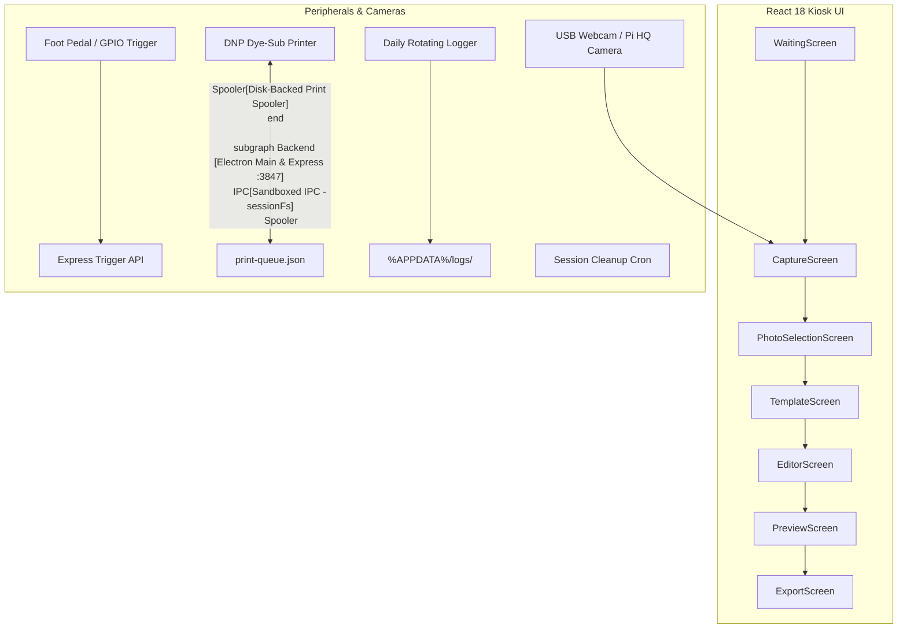
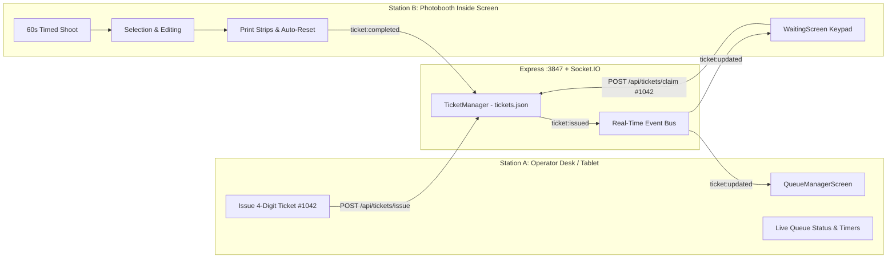

# 📸 Photobooth Kiosk Appliance — Commercial Operating System

> **Commercial Event-Grade Photobooth Software** designed for unattended kiosks, physical photo booths, and wedding/corporate activations. Built with **Electron**, **Node.js/Express**, **React 18**, **TypeScript**, and **Sharp**. Comparable to Darkroom Booth, Simple Booth, and DNP appliance operating systems.

---

## 📑 Table of Contents

1. [Quick Start & Development](#-quick-start--development)
2. [Passwords & Admin Access](#-passwords--admin-access)
3. [Architecture Overview](#-architecture-overview)
4. [Digital Queue & Dual-Station Architecture](#-digital-queue--dual-station-architecture)
5. [Capture Engine & Marathon Shoot Mode (60s / 30-Shots)](#-capture-engine--marathon-shoot-mode)
6. [Photo Selection: Studio Grid vs. Masonry](#-photo-selection-studio-grid-vs-masonry)
7. [Sticker Customization Engine & Auto-Cropper](#-sticker-customization-engine--auto-cropper)
8. [Magic Template Studio (Auto Window Detection)](#-magic-template-studio-auto-window-detection)
9. [Hardware & Peripheral Integration](#-hardware--peripheral-integration)
10. [Print Spooler & Paper Roll Management](#-print-spooler--paper-roll-management)
11. [DevSecOps, Sandboxing & Security Lockdown](#-devsecops-sandboxing--security-lockdown)
12. [Project Directory Structure](#-project-directory-structure)
13. [CLI Commands Reference](#-cli-commands-reference)

---

## 🚀 Quick Start & Development

### Prerequisites
* **Node.js:** v20.x or v22.x LTS (tested up to Node v24)
* **OS:** Windows 10/11 (PowerShell) or Linux (Ubuntu/Debian on Raspberry Pi 4/5)
* **Printer Driver:** DNP (DS-RX1HS / DS620), Citizen, Sinfonia, or Windows Virtual PDF printer

### Installation & Run

```powershell
# 1. Clone & install dependencies
git clone <repo-url> Photobooth
cd Photobooth
npm install

# 2. Start full development environment (Vite UI + Express backend server concurrently)
npm run dev

# 3. Or run components individually:
npm run dev:vite    # Frontend only (http://localhost:5173)
npm run dev:server  # Standalone backend server (http://127.0.0.1:3847)
```

### Build & Production

```powershell
# Typecheck TypeScript
npm run typecheck

# Compile production web bundle (dist/)
npm run build

# Preview production build locally
npm run preview
```

---

## 🏁 Running at an Event (Production)

```powershell
# On the ticket-desk laptop (it runs the server and is the "staff" machine)
copy .env.example .env          # fill in Razorpay keys + STAFF_PIN
npm run build                   # once per code change
npm start                       # UI + API + media on ONE port: http://<laptop-ip>:3847
```

| Station | Device | Open |
| :--- | :--- | :--- |
| Ticket desk | Laptop (runs the server) | `http://localhost:3847/?view=ticket` |
| Photobooth | Raspberry Pi 4 + Camera Module 3 | automatic — run `pi-setup/setup-kiosk-client.sh` once; at every boot the Pi finds the laptop itself |
| Editing station | iPad (Safari, Add to Home Screen) | scan the **Connect iPad** QR in the ticket desk's Printer & devices panel |

**Plans** (one file: `src/constants/pricing.ts`): ₹99 = 2 strips (1 A5) · ₹169 = 4 strips (2 A5) · ₹229 = 6 strips (3 A5).
Editing-station add-on: +₹79 per extra A5 sheet (2 strips).

**Printing** — guests print from the iPad as before, but the sheet goes iPad → laptop → Wi-Fi printer over IPP
(the protocol AirPrint uses), so there is no iOS print dialog and the server enforces copies per ticket. The
printer is found automatically (PDF, JPEG or PWG raster printers). If no network printer is found, the
iPad falls back to AirPrint.

**Payments** — UPI uses a one-time Razorpay QR for the exact amount that confirms itself (server polls
Razorpay; works even if the screen is closed). Cash is confirmed by the attendant. The old static UPI QR only
appears if Razorpay QR Codes is unavailable.

**Staff PIN** — requests from the laptop itself are trusted. The iPad and Pi are *guest-facing*: anything
that touches money (mark paid, cash/UPI upgrade, reprint, issue/void tickets) needs the staff PIN, which
the server checks (`STAFF_PIN` in `.env`, otherwise `data/staff-pin.txt`). 5 wrong tries → 60 s lockout.

**Ticket lifecycle** enforced by the server for guest stations:
`WAITING → IN_BOOTH → EDITING → PRINTING → COMPLETED`. A ticket can be shot once; if the booth crashes
before any photo uploads, the same code can be re-entered. Staff can force any status from the desk.

**Pi camera** — `public/pi-camera.py` uses picamera2: real 2304×1296 stills (sensor binned mode),
hardware-encoded live preview, zoom without restarting. Env knobs: `STILL_W/STILL_H` (4608×2592 for full
12 MP), `STILL_QUALITY`, `CAMERA_HDR=1`, `CAMERA_BACKEND=rpicam` (force legacy).

> ⚠️ The Razorpay secret that used to be hard-coded in `server/routes/payments.ts` was pushed to GitHub.
> Rotate it in the Razorpay dashboard and put the new keys only in `.env`.

---

## 🔐 Passwords & Admin Access

### 1. Default Admin Credentials
* **Default Admin PIN:** `1234`
* **Encryption:** Stored as a salted SHA-256 hash in local settings (`settingsStore.ts`).
* **Changing the PIN:** Open the Admin Panel → Navigate to **Security / Kiosk Settings** → Enter your new 4–8 digit PIN → Save.

### 2. How to Open the Admin Panel on the Kiosk
The admin access is intentionally concealed from guests through discrete gestures:

| Method | Trigger Action | Where |
| :--- | :--- | :--- |
| **Keyboard Shortcut** | `Ctrl + Shift + A` *(or `Cmd + Shift + A` on macOS)* | Any screen |
| **Discrete Touch Gesture 1** | **Tap 5 times rapidly** within 3 seconds | Top-Left Brand Logo / Wordmark (`AppHeader`) |
| **Discrete Touch Gesture 2** | **Long-Press & Hold for 4 seconds** | Top-Left Brand Logo / Wordmark (`AppHeader`) |

When triggered, an animated PIN keypad appears. Enter `1234` to unlock the full operator dashboard.

### 3. Third-Party Service Credentials (Configured in Admin Panel)
* **SMTP Guest Email Delivery:** Configurable host, port (465/587), SSL/TLS toggle, SMTP Username, and SMTP App Password.
* **Twilio SMS Delivery:** Configurable Account SID, Auth Token, and From Phone Number.
* **Local Backend API Port:** `3847` (Express Server with WebSocket broadcast on `ws://localhost:3847`).

---

## 🏛️ Architecture Overview

The system runs a **dual-engine architecture** designed to operate 100% offline at remote venues with zero internet dependency:



* **Vite + React 18 Frontend:** Smooth 60 FPS kiosk animations (`framer-motion`), minimum 48px touch targets, Web Audio synthesizer, and state persistence with `zustand`.
* **Electron Main Process:** Native silent printing, disk queue persistence, OS-level window lockdown, and sandboxed file system operations.
* **Local Express API (`:3847`):** High-speed image streaming, hardware trigger webhooks, Socket.IO live events, and background worker queues.

---

## 🎟️ Digital Queue & Dual-Station Architecture

To eliminate customer photo overlap and seamlessly manage high-volume event throughput, the system implements a **two-station digital queue architecture** synchronized over local websockets:



### Station A: Operator Ticket & Queue Controller
* **Remote Access URL:** `http://<booth-ip>:5173/?view=queue` or click **`Station A: Ticket Desk`** at the bottom of the kiosk screen.
* **Capabilities:**
  * Issues sequential 4-digit ticket codes (`#1001`, `#1002`, `#1003`...) or custom codes.
  * Captures guest/group names and mobile numbers for digital SMS delivery.
  * Instant Photobooth Access Pass modal with prominent 4-digit code and QR code for the guest.
  * Real-time kanban tracking across 5 stages: `WAITING` ➔ `IN_BOOTH` ➔ `EDITING` ➔ `PRINTING` ➔ `COMPLETED`.
  * Live photo counters, session timers, and queue throughput metrics.
  * Remote "Call Next", "Void", and "Reset Queue" tools.

### Station B: Photobooth Inside Screen (Touch Keypad)
* **Opening Screen (`WaitingScreen`):** Prominently features a tactile 4-digit numeric keypad with glowing active code slots.
* **Dual Input:** Works with touch gestures on the screen or physical keyboard numeric typing (0–9, Backspace, Enter).
* **Instant Verification:** Validates the ticket with the server, displays *"Ticket #1042 Verified • Welcome [Name]"*, and unlocks the shoot.
* **Walk-In Pass Support:** If enabled in settings, guests without tickets can tap *"No ticket? Tap for walk-in pass"* to be auto-ticketed and admitted immediately.

### Zero Photo Overlap Guarantee
* Every photo captured in a session is strictly locked to that guest's `ticketId`.
* Photo Selection, Layouts, Templates, Stickers, and Printing screens only display and manipulate pictures from that specific active ticket.
* Upon print completion or session reset, all photo data and canvas elements in memory are wiped clean before the booth accepts the next ticket code.

---

## ⚡ Capture Engine & Marathon Shoot Mode

### Camera Sources Supported
Configurable in Admin Panel (`cameraSource`):
1. **`webcam`:** Standard USB capture or integrated laptop camera via HTML5 WebRTC `getUserMedia`.
2. **`pi_network`:** High-resolution DSLR or Raspberry Pi Camera Module streaming frames over LAN Socket.IO.
3. **`demo`:** Instant software simulation using all **14 preloaded studio demo pictures**.

### Marathon 60-Second Shoot Mode (30 Photos)
Designed for high-energy activations, editorial photo shoots, and creative booth sessions:
* **Session Duration:** 60 seconds continuous session.
* **Interval Between Shots:** 1 photo every 2 seconds (configurable in settings).
* **Photo Yield:** Up to **30 high-resolution pictures** per guest session.
* **Audio Synthesis Engine:** Native Web Audio API synthesizer (`src/utils/audio.ts`) with gesture unlock on first touch (`unlockAudioContext()`). Emits 3-2-1 pitch-shifted countdown beeps and a photobooth shutter click.
* **Smart Offline Caching:** Automatically detects server connectivity on Shot 1. If offline, immediately switches to 0ms instant local storage for shots 2–30 with zero UI freezes or network timeouts.
* **Early Exit Button:** Guests can tap *"Finish Early ({count} Photos)"* at any time once 4 photos have been captured.

---

## 🖼️ Photo Selection: Studio Grid vs. Masonry

On [`PhotoSelectionScreen.tsx`](file:///c:/projects/Photobooth/src/screens/PhotoSelectionScreen.tsx), guests review their session photos and select their favorites for the photo strip:

### 1. Clean Uniform Studio Grid (Default)
* **Uncropped 3:2 Ratio:** Retains 100% of the camera sensor frame. Faces, hair, and group members on the edges are never cropped.
* **Sequential Ordering:** Clear left-to-right, row-by-row chronological order.
* **Side-by-Side Pose Comparison:** Cards align on identical baselines so guests can compare subtle facial expressions across shots.
* **High-Visibility Badges:** High-contrast `#{01}` through `#{30}` badges in the top-left corner.
* **Density Controls:** Quick toolbar toggle for **8 in a row** (Compact), **6 in a row** (Standard), or **4 in a row** (Large).

### 2. Pinterest Moodboard Mode
* Operators can switch between **`[STUDIO GRID]`** and **`[MOODBOARD]`** via the top toolbar toggle for an artistic, staggered lifestyle presentation.

---

## 🎨 Sticker Customization Engine & Auto-Cropper

Guests can decorate their photo strips in [`EditorScreen.tsx`](file:///c:/projects/Photobooth/src/screens/EditorScreen.tsx) with custom stickers that print at **300 DPI**.

### Pre-Installed Sticker Library (34 Stickers)
Organized into 5 curated collections in `public/stickers/`:

* **🛹 Streetwear & Skate:** Nike Air Jordan 1 Chicagos, NY Yankees Cap, Vans "Off The Wall", "JUST DO IT.", Checkered Skateboard Deck, Vivienne Westwood label.
* **📻 Retro & Vintage:** Vintage 1936 Sign, Japanese Marlboro anime juice box, Coca-Cola 6-pack bottles, BASF Tape Cassette, Cinema Admit One ticket, Memories Smile License Plate, Delicious Cheesecake tin sign, Exit arrow sign.
* **⚡ Pop Culture & Anime:** Bugs Bunny "What's Up Doc" badge, Spider-Man Mask badge, Spider hero back emblem, Ghostface Ghostbusters, Straw Hat Pirate Skull (One Piece), Paper Plane Astronaut, Space Cat Cosmonaut, Main Character Clapperboard.
* **🏎️ Cars & Garage:** Nissan Skyline GT-R R34, Porsche 911 Unleash The Legend poster, Porsche 911 Turbo Widebody rear, Classic Garage muscle car sign, Checkered finish line flags.
* **🎸 Music & Vibes:** The Rolling Stones Sticky Fingers tongue badge, Red Electric Guitar, DJ Headphones, Lucky Red Casino Dice, Bloody Four Aces Poker Hand, Laughing Skull with Star Eyes, Apple Music Note icon.

### Canvas Sticker Features
* **Touch / Mouse Drag:** Drag stickers freely across strips.
* **Size Slider:** Scale stickers from 60px to 480px while maintaining natural aspect ratio.
* **Rotation Slider:** Rotate -180° to +180° with a 1-tap **`0°` snap button**.
* **Opacity Slider:** Adjust transparency from 20% to 100%.
* **Layering Controls:** Bring forward (`▲ Front`) or send backward (`▼ Back`).
* **Quick Actions:** Duplicate and Delete (with trash icon and corner quick-delete button).
* **Live Export:** Stickers render in real-time on [`PreviewScreen.tsx`](file:///c:/projects/Photobooth/src/screens/PreviewScreen.tsx) and composite onto the high-resolution canvas in [`ExportScreen.tsx`](file:///c:/projects/Photobooth/src/screens/ExportScreen.tsx) for 300 DPI physical prints and digital downloads.

---

### Autonomous Tool: Crop & Sort Your "Full Collection"
You can auto-crop and sort entire sticker sheets in two ways:

#### Option A: Command-Line Auto-Cropper (Batch Tool)
Run in PowerShell:
```powershell
# Auto-crop a single sheet image into a category:
npm run extract-stickers ./path-to-sheet.png streetwear

# Auto-crop an entire folder of sheets at once:
npm run extract-stickers ./my-new-sticker-sheets/ retro
```

**How the Algorithm Works (`scripts/autoExtractStickerSheet.cjs`):**
1. Automatically analyzes perimeter pixels to identify the sheet background (pure white `#fff`, transparent, light gray `#e4e4e4`, or checkerboard pattern).
2. Executes flood-fill from the image boundary to isolate background space from foreground stickers.
3. Runs 8-way Connected Component Labeling to locate every distinct sticker.
4. Preserves the white die-cut contour border while making the outer sheet transparent.
5. Auto-trims excess whitespace, outputs crisp PNGs to `public/stickers/<category>/`, and automatically updates `stickers_manifest.json`.

#### Option B: In-App "+ Auto-Crop" Modal (No Terminal Required)
1. Open the Strip Editor and tap the **STICKERS** tab.
2. Click **`+ Auto-Crop`** in the search toolbar.
3. Drag & drop any sticker sheet image (PNG, JPG, WebP).
4. The built-in HTML5 Canvas computer vision engine auto-detects all stickers in real-time.
5. Select the category and click **`Crop & Import`** to immediately add them to your kiosk library.

---

## 🪄 Magic Template Studio (Auto Window Detection)

The kiosk includes an intelligent template creation tool (`MagicTemplateStudioModal.tsx`):
1. **Upload Any Overlay Artwork:** Drop any PNG overlay with transparent photo cutouts (or solid frame art).
2. **Auto Window Cutout Detection:**
   * Scans the alpha channel and luminance of the image.
   * Automatically isolates transparent or placeholder windows.
   * Auto-calculates exact slot coordinates: `x`, `y`, `width`, `height`.
3. **Interactive Visual Slot Editor:**
   * Drag, resize, and fine-tune slot placement.
   * Lock aspect ratios (`3:2`, `4:3`, `1:1`, `Polaroid`).
   * Live preview with sample demo photos inside each slot.
4. **Instant 1-Click Save:** Saves directly to the kiosk template library for immediate use.

---

## 🖨️ Print Spooler & Paper Roll Management

### 1. Persistent Disk-Based Spooler (`%APPDATA%/print-queue.json`)
* In commercial booth environments, power cuts and kiosk restarts can cause memory-only print queues to vanish.
* This application writes every queued print job to `%APPDATA%/print-queue.json` with an atomic file write.
* On reboot or app launch, the spooler automatically resumes pending jobs with retry limits and exponential backoff.

### 2. Silent Native Printing
* Uses Electron's native `webContents.print({ silent: true, printBackground: true })` directed to the default dye-sub printer.
* Bypasses the Windows system print dialog for a 100% unattended physical kiosk experience.

### 3. Paper Roll Tracking & Low-Paper Guard
Configured in Admin Settings:
* **Roll Capacity:** Configurable (e.g., 400 prints for standard 4x6" rolls, 700 prints for jumbo rolls).
* **Cuts Remaining Counter:** Decrements by 1 on every successful physical print cut.
* **Low Paper Warning:** Displays an alert banner to operators when roll falls below 20 prints.
* **Auto-Lock on Empty:** Prevents guests from queuing prints when roll reaches 0 to avoid printer head jamming.
* **Reset Button:** Operators can click *"Reset to Full Roll"* after replacing paper and ribbon.

---

## 🔒 DevSecOps, Sandboxing & Security Lockdown

Designed to run in public venues without risk of guest tampering or unauthorized LAN access:

1. **Kiosk Window Lockdown:**
   * Runs in fullscreen kiosk mode (`kiosk: true`, `alwaysOnTop: true`).
   * Blocks common escape keystrokes: `F11`, `F12` (DevTools), `Alt+F4`, `Ctrl+R`, `Ctrl+Shift+I`, and right-click context menus.
2. **IPC Path Traversal Defense (`assertSafePath`):**
   * All file operations via IPC (`sessionFs:*`) validate requested paths against `%APPDATA%` and the designated session root using strict prefix verification.
   * Any attempt to pass `../` or escape the sandbox throws an immediate security violation.
3. **Parameterized LAN Streaming:**
   * Removed all raw `express.static` folder browsing.
   * Media streaming is guarded by `/sessions/:sessionId/:folder/:filename` route verification.
4. **Constant-Time Crypto Tokens:**
   * Session authentication uses `crypto.timingSafeEqual` with length checks to prevent timing side-channel attacks over LAN.
5. **Rotating Audit Logs:**
   * Daily rotating logs stored in `%APPDATA%/logs/` (`photobooth-YYYY-MM-DD.log`).
   * Automatically purges logs older than 7 days to preserve disk space.
6. **Session Auto-Cleanup:**
   * Automated cleanup service purges temp cache and session files older than 48 hours (`/api/session/cleanup`).

---

## 📁 Project Directory Structure

```text
Photobooth/
├── electron/                         # Electron Main & Backend Process
│   ├── main.ts                       # Main process entry, kiosk window, IPC handlers
│   ├── preload.ts                    # Context isolation bridge (window.electronAPI)
│   ├── printSpooler.ts               # Persistent disk spooler (%APPDATA%/print-queue.json)
│   ├── logger.ts                     # Daily rotating logger (%APPDATA%/logs/)
│   └── server/                       # Embedded Express API server (Port 3847)
│       ├── index.ts                  # Server initialization, CORS, Socket.IO
│       └── routes/                   # Sessions, photos, print, email, SMS routes
│
├── public/                           # Static assets served by Vite
│   ├── demo-photos/                  # 14 high-resolution sample photos (1.jpg - 14.jpg)
│   ├── stickers/                     # Organized sticker collection & manifest
│   │   ├── motorsport/               # Car, racing, and garage stickers
│   │   ├── music_misc/               # Rock, guitar, dice, cards, headphones
│   │   ├── pop_culture/              # Anime, cartoons, space, superheroes
│   │   ├── retro/                    # Cassettes, tickets, signs, license plates
│   │   ├── streetwear/               # Jordans, Vans, skate, typography
│   │   └── stickers_manifest.json    # JSON index of all stickers (tags, sizes, URLs)
│   └── templates/                    # Pre-designed print frames & overlays
│
├── scripts/                          # Automated Tooling & Extraction Pipelines
│   ├── autoExtractStickerSheet.cjs   # Autonomous CLI sticker sheet auto-cropper
│   ├── extractAllStickers.cjs        # Master extraction script
│   └── stickerCatalog.cjs            # Calibrated sticker definitions
│
├── src/                              # React 18 Frontend Application
│   ├── screens/                      # Main photobooth kiosk screens
│   │   ├── WaitingScreen.tsx         # Idle attractor, touch to start, demo roll
│   │   ├── CaptureScreen.tsx         # 60s marathon shoot, countdown, audio cues
│   │   ├── PhotoSelectionScreen.tsx  # Uniform Studio Grid vs Moodboard
│   │   ├── LayoutScreen.tsx          # 1-strip, 2-strip, grid, or collage selection
│   │   ├── TemplateScreen.tsx        # Frame theme picker
│   │   ├── EditorScreen.tsx          # Filters, adjustments, stickers, text editor
│   │   ├── PreviewScreen.tsx         # Live photorealistic strip preview
│   │   └── ExportScreen.tsx          # 300 DPI canvas export, silent print, QR code
│   │
│   ├── components/
│   │   ├── editor/
│   │   │   └── StickerPanel.tsx      # Sticker browser, inspector, in-app auto-cropper
│   │   ├── modals/
│   │   │   ├── AdminPanelModal.tsx   # Operator control center (PIN: 1234)
│   │   │   └── MagicTemplateStudioModal.tsx # Auto transparent window cutout maker
│   │   ├── kiosk/
│   │   │   ├── CameraViewfinder.tsx  # WebRTC / Pi live camera viewfinder
│   │   │   └── IdleTimeoutManager.tsx# Inactive session timeout & reset countdown
│   │   └── layout/
│   │       ├── AppHeader.tsx         # Header with discrete admin touch gestures
│   │       └── AppFooter.tsx         # Navigation action bar
│   │
│   ├── store/                        # State management (Zustand)
│   │   ├── sessionStore.ts           # Active photos, strips, and canvas elements
│   │   ├── settingsStore.ts          # Kiosk settings, PIN hash, hardware config
│   │   └── historyStore.ts           # Undo/redo stack
│   │
│   └── utils/
│       ├── audio.ts                  # Web Audio synthesizer & gesture unlock
│       └── printSpooler.ts           # Frontend print trigger & roll tracker
│
├── package.json                      # Scripts and dependencies
├── vite.config.ts                    # Vite bundle configuration
└── tsconfig.json                     # TypeScript compiler configuration
```

---

## 🛠️ CLI Commands Reference

| Command | Action |
| :--- | :--- |
| `npm run dev` | Starts Vite dev server and launches Electron kiosk in parallel |
| `npm run dev:vite` | Starts standalone Vite server (`http://localhost:5173`) for browser-only UI testing |
| `npm run dev:electron` | Waits for Vite server and launches the Electron desktop shell |
| `npm run build` | Compiles both Electron TypeScript (`dist-electron/`) and Vite assets (`dist/`) |
| `npm run build:electron` | Packages full standalone desktop installer (`release/`) via `electron-builder` |
| `npm run typecheck` | Validates TypeScript types across all frontend and backend source files |
| `npm run extract-stickers <file/dir> [cat]` | **Auto-crops any sticker sheet image/folder and imports into library** |

---

## 💡 Operator Troubleshooting & Tips

* **Audio Not Playing on First Shot?** The browser requires user interaction before playing Web Audio. Touching "START" automatically invokes `unlockAudioContext()`.
* **Testing Without a Camera?** In Admin Panel (`Ctrl+Shift+A` → PIN `1234`), set **Camera Source** to `Demo Simulation` or click **"Quick Demo Roll"** on the Waiting Screen to load all 14 sample studio shots instantly.
* **Printer Out of Paper?** When the physical roll runs out, replace the paper and ribbon roll, open Admin Panel → Printer Settings, and tap **"Reset to Full Roll"**.
* **Adding New Sticker Sheets?** Simply place your sheet image in the project and run `npm run extract-stickers ./my-sheet.png streetwear` (or use the `+ Auto-Crop` button inside the editor)!

---

*Made with ❤️ for high-performance physical photo booths and commercial kiosk appliances.*
